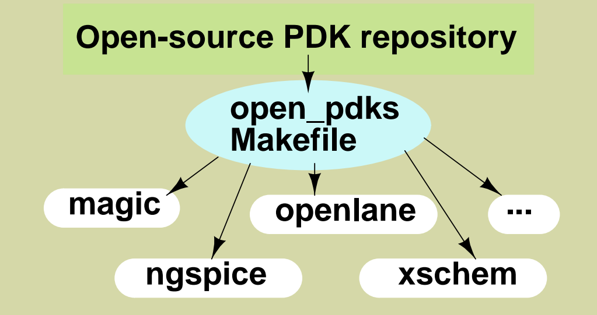
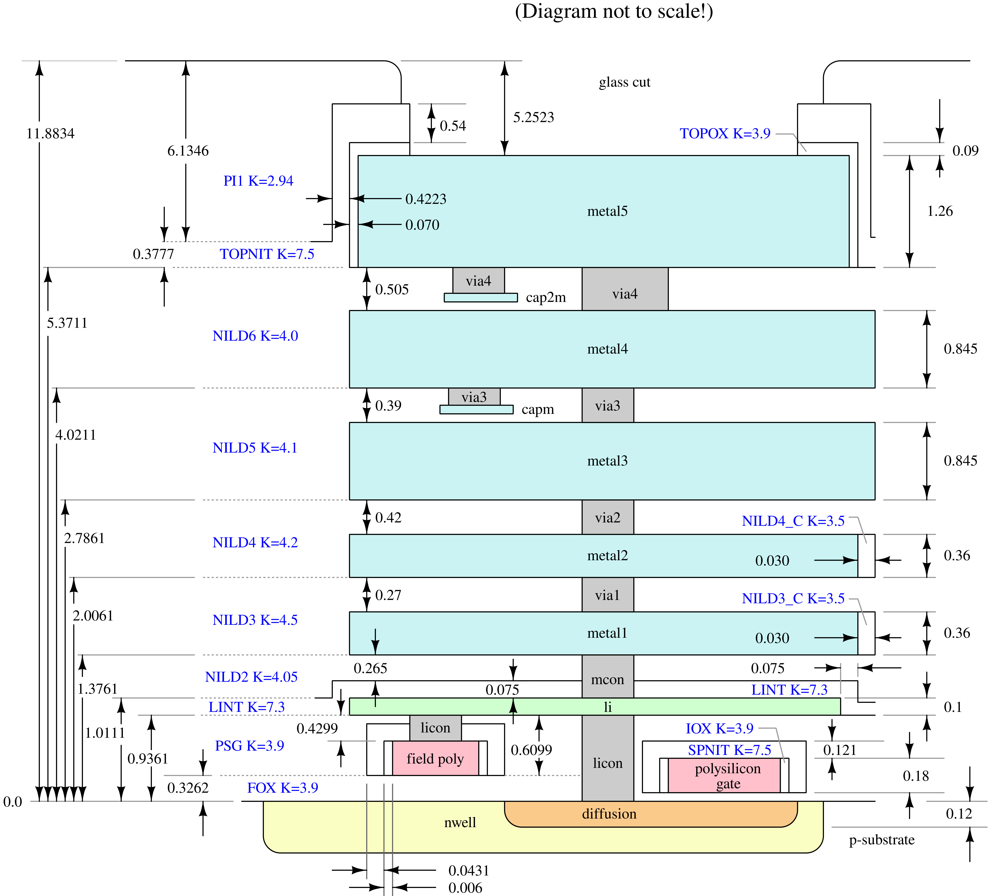

# SKY130A Physical Verification – VLSI Design

Implementation and documentation of a SKY130A-based VLSI physical design and verification flow using open-source EDA tools, including Magic, Netgen, ngspice, Xschem, and Open_PDKs. Covers PDK setup, schematic design, circuit simulation, layout design, DRC, LVS, and physical verification.

# Sky130 Open-Source VLSI Tool Setup

This repository documents my hands-on setup and initial launch checks for an open-source VLSI design environment on **Ubuntu 24.04.5 LTS** running in **Oracle VirtualBox**.

The tools explored are **Magic**, **Netgen**, **ngspice**, and **Xschem**, along with Git.

The goal is to prepare an environment for learning schematic capture, circuit simulation, layout design, and physical-verification concepts using the SkyWater SKY130A process.

## Open-Source PDK Architecture

The following diagram illustrates the open-source PDK ecosystem and the role of the `open_pdks` repository in supporting different open-source EDA tools.

**Reference:** Architecture diagram provided by the instructor.

## Environment

- **Operating System:** Ubuntu 24.04.5 LTS (Noble)
- **Virtualization:** Oracle VirtualBox
- **Git:** 2.43.0
- **EDA Tools:** Magic, Netgen, ngspice, Xschem
- **PDK:** SkyWater SKY130A

## Progress Summary

- Installed and configured the Ubuntu environment.
- Confirmed Git installation.
- Installed and checked Magic, Netgen, ngspice, and Xschem.
- Explored the SKY130A PDK environment.
- Captured screenshots of tool installation and launch checks.

**Note:** These screenshots demonstrate initial installation and launch checks. They do not independently establish that a complete schematic-to-layout physical verification flow has passed.

## Screenshots and Documentation

### 1. Ubuntu Environment

Ubuntu 24.04.5 LTS running inside Oracle VirtualBox.

### 2. Git Installation Verification

Verified Git installation using the `git --version` command.

### 3. Magic Installation

Terminal screenshot showing the Magic installation and setup process.

### 4. Magic Layout Tool

Magic VLSI layout editor successfully launched with its graphical interface and Tcl console.

### 5. Netgen Tool

Netgen launched successfully. Netgen is used for Layout-versus-Schematic (LVS) verification.

### 6. ngspice Tool

ngspice launched successfully and displayed its interactive simulation prompt.

### 7. Xschem Tool

Xschem schematic editor launched successfully.

### 8. Xschem Library Reference

Screenshot showing the Xschem library and symbol reference interface.

## Tools and Their Roles

| Tool | Main Purpose |
|---|---|
| Xschem | Schematic capture and SPICE netlist generation |
| ngspice | Analog and mixed-signal circuit simulation |
| Magic | IC layout design and Design Rule Checking (DRC) |
| Netgen | Layout-versus-Schematic (LVS) comparison |
| Open_PDKs | Process Design Kit installation and configuration |
| Git | Version control and repository management |

## Next Steps

1. Verify SKY130A PDK configuration and technology files.
2. Configure Xschem with SKY130A libraries.
3. Configure Magic with the SKY130A technology file.
4. Design a CMOS inverter schematic using Xschem.
5. Generate the SPICE netlist.
6. Simulate the inverter using ngspice.
7. Create the corresponding layout using Magic.
8. Run DRC and fix design-rule violations.
9. Extract the layout netlist.
10. Perform LVS verification using Netgen.

## Learning Focus

Understanding the complete open-source custom IC design workflow:

**Schematic Design → SPICE Simulation → Layout Design → DRC → Parasitic Extraction → LVS Verification**

---

# CMOS Inverter Design and Simulation Using Xschem

This section documents the design and simulation of a CMOS inverter using Xschem and the SKY130A PDK.

The inverter is implemented using SKY130A PMOS and NMOS transistors. The schematic is converted into a reusable symbol and simulated using ngspice to verify the inverter's transient response.

## 1. CMOS Inverter Schematic Design

Designed a CMOS inverter using SKY130A PMOS and NMOS transistors in Xschem.

## 2. Schematic Converted into Symbol

Converted the inverter schematic into a reusable hierarchical symbol for testbench integration.

## 3. Inverter Testbench Design

Created an inverter testbench using Xschem with input voltage source, power supply, and SKY130A model library.

## 4. Transient Simulation Waveform

Simulated the CMOS inverter using ngspice. The waveform shows the input and output voltage responses, demonstrating the inversion operation.

## 5. ngspice Simulation Results

Executed the transient simulation using ngspice and observed the inverter output response.

## Design and Simulation Flow

**Xschem Schematic Design → Symbol Generation → Testbench Creation → SPICE Netlist → ngspice Simulation → Waveform Analysis**

---

# CMOS Inverter Physical Layout and Verification Using Magic

This section documents the physical layout implementation and verification of a CMOS inverter using the SKY130A PDK and open-source EDA tools.

The layout was generated using Magic with SKY130A PMOS and NMOS devices. Design Rule Checking (DRC), layout extraction, SPICE netlist generation, and Layout-versus-Schematic (LVS) verification were performed.

## 1. Magic Layout Tool Setup

Launched Magic with the SKY130A technology configuration for CMOS inverter physical layout implementation.

## 2. PMOS Transistor Parameters

Configured SKY130A PMOS transistor parameters, including width, length, finger count, and device properties.

## 3. NMOS Transistor Parameters

Configured SKY130A NMOS transistor parameters for the CMOS inverter layout.

## 4. CMOS Inverter Physical Layout

Implemented the CMOS inverter physical layout using SKY130A PMOS and NMOS devices with input (vin), output (vout), VDD, and VSS connections.

## 5. Design Rule Checking (DRC)

Performed DRC verification using Magic. The reported result shows:

- Total DRC errors found: 0
- No errors found.

## 6. Layout Extraction and SPICE Netlist Generation

Performed layout extraction using Magic commands:

- `extract do local`
- `extract all`
- `ext2spice lvs`
- `ext2spice`

The extracted layout information was converted into a SPICE netlist for further verification.

## 7. Layout-versus-Schematic (LVS) Verification

Performed LVS verification using Netgen by comparing the schematic and extracted layout netlists.

**Verification Result:**
- Circuit 1 contains 2 devices.
- Circuit 2 contains 2 devices.
- Both circuits contain 4 nets.
- Final result: Circuits match uniquely.
- LVS Done.

## Physical Design and Verification Flow

**Xschem Schematic → Magic Layout Generation → DRC Verification → Layout Extraction → SPICE Netlist Generation → Netgen LVS Verification**

## Verification Summary

| Verification Stage | Tool | Result |
|---|---|---|
| Physical Layout | Magic | Completed |
| PMOS/NMOS Configuration | Magic | Completed |
| DRC | Magic | 0 Errors |
| Layout Extraction | Magic | Completed |
| SPICE Netlist Generation | Magic | Completed |
| LVS | Netgen | Circuits Match Uniquely |

---

# SKY130A Metal Layer Stack and Cross-Section

The following diagram illustrates the SKY130A technology stack, including metal interconnect layers, vias, polysilicon, diffusion, and substrate layers.

## Diagram Overview

The cross-section represents the different fabrication layers used in the SKY130A process:

- **Metal Layers:** Metal1 to Metal5 for electrical interconnections.
- **Via Layers:** Via1 to Via4 for connections between metal layers.
- **Polysilicon:** Used for MOSFET gate formation.
- **Diffusion:** Source and drain regions.
- **N-Well and P-Substrate:** Semiconductor regions forming the device structure.
- **Dielectric Layers:** Insulating layers between conductive structures.

This diagram is included as a technology reference for understanding the SKY130A fabrication stack and physical layout design.

*Reference: SKY130A process stack diagram.*

