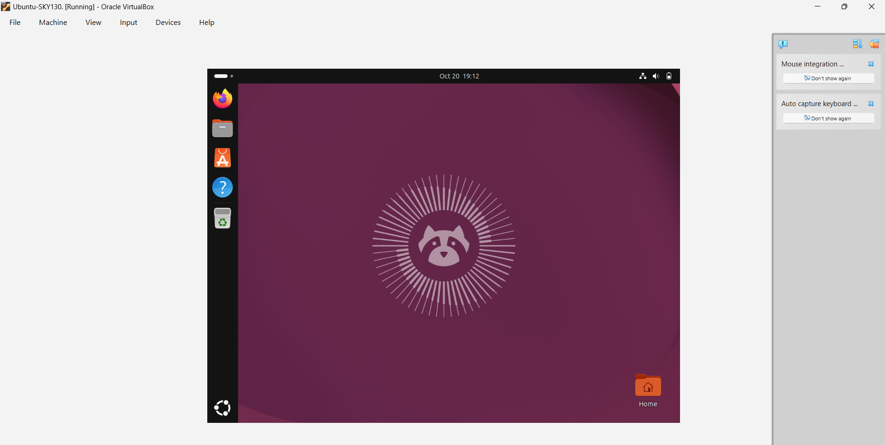

# SKY130A Physical Verification – VLSI Design

Implementation and documentation of a SKY130A-based VLSI physical design and verification flow using open-source EDA tools, including Magic, Netgen, ngspice, Xschem, and Open_PDKs. Covers PDK setup, schematic design, circuit simulation, layout design, DRC, LVS, and physical verification.

# Sky130 Open-Source VLSI Tool Setup

This repository documents my hands-on setup and initial launch checks for an open-source VLSI design environment on **Ubuntu 24.04.5 LTS** running in **Oracle VirtualBox**.

The tools explored are **Magic**, **Netgen**, **ngspice**, and **Xschem**, along with Git.

The goal is to prepare an environment for learning schematic capture, circuit simulation, layout design, and physical-verification concepts using the SkyWater SKY130A process.

## Environment

- **Operating System:** Ubuntu 24.04.5 LTS (Noble)
- **Virtualization:** Oracle VirtualBox
- **Git:** 2.43.0
- **EDA Tools:** Magic, Netgen, ngspice, Xschem
- **PDK:** SkyWater SKY130A

## Progress Summary

- Installed and configured the Ubuntu environment.
- Confirmed Git installation.
- Installed and checked Magic, Netgen, ngspice, and Xschem.
- Explored the SKY130A PDK environment.
- Captured screenshots of tool installation and launch checks.

**Note:** These screenshots demonstrate initial installation and launch checks. They do not independently establish that a complete schematic-to-layout physical verification flow has passed.

## Screenshots and Documentation

### 1. Ubuntu Environment

Ubuntu 24.04.5 LTS running inside Oracle VirtualBox.

### 2. Git Installation Verification

Verified Git installation using the `git --version` command.

### 3. Magic Installation

Terminal screenshot showing the Magic installation and setup process.

### 4. Magic Layout Tool

Magic VLSI layout editor successfully launched with its graphical interface and Tcl console.

### 5. Netgen Tool

Netgen launched successfully. Netgen is used for Layout-versus-Schematic (LVS) verification.

### 6. ngspice Tool

ngspice launched successfully and displayed its interactive simulation prompt.

### 7. Xschem Tool

Xschem schematic editor launched successfully.

### 8. Xschem Library Reference

Screenshot showing the Xschem library and symbol reference interface.

## Tools and Their Roles

| Tool | Main Purpose |
|---|---|
| Xschem | Schematic capture and SPICE netlist generation |
| ngspice | Analog and mixed-signal circuit simulation |
| Magic | IC layout design and Design Rule Checking (DRC) |
| Netgen | Layout-versus-Schematic (LVS) comparison |
| Open_PDKs | Process Design Kit installation and configuration |
| Git | Version control and repository management |

## Next Steps

1. Verify SKY130A PDK configuration and technology files.
2. Configure Xschem with SKY130A libraries.
3. Configure Magic with the SKY130A technology file.
4. Design a CMOS inverter schematic using Xschem.
5. Generate the SPICE netlist.
6. Simulate the inverter using ngspice.
7. Create the corresponding layout using Magic.
8. Run DRC and fix design-rule violations.
9. Extract the layout netlist.
10. Perform LVS verification using Netgen.

## Learning Focus

Understanding the complete open-source custom IC design workflow:

**Schematic Design → SPICE Simulation → Layout Design → DRC → Parasitic Extraction → LVS Verification**

## Repository Status

**Current Status:** EDA tool installation and initial environment verification completed. Practical SKY130A design and physical verification are the next development stages.
